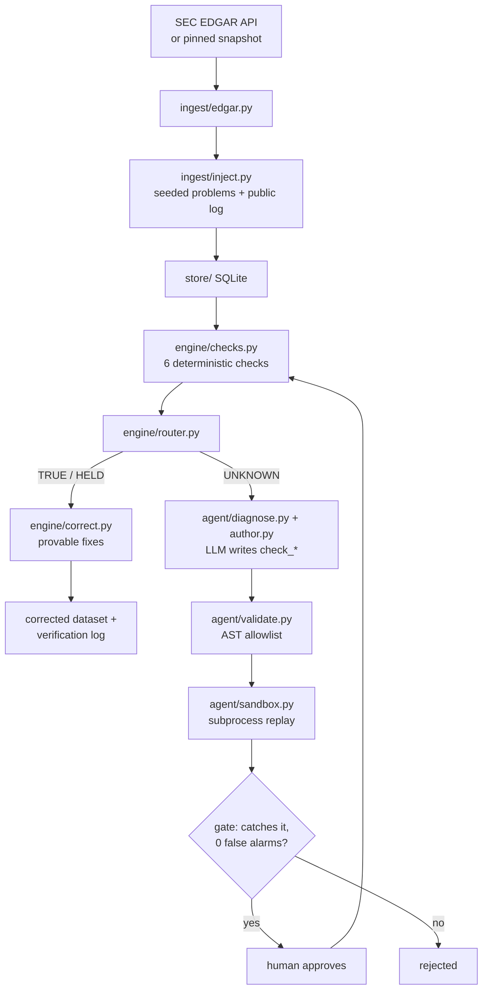

# Touchstone

**Live demo:** https://touchstone-tech.vercel.app (offline mode: no API key, runs on Vercel serverless)

<p align="center"></p>

> A data lie-detector for financial pipelines: every SEC 13F row must prove itself, provably-wrong rows are auto-fixed, and new failure patterns get a new check written by an LLM agent — behind a sandbox, a replay gate, and human approval.

Built at the OpenAI Codex Community Hackathon (Pune, 2026).

## Screenshots

> _TODO: add screenshots / GIF of `ui/console.html` (run table, agent gate, approval)._
>
> `docs/screenshots/console.png` · `docs/screenshots/agent-gate.png`

## The problem

A normal pipeline turns green when a row *loads* — even if the row is outdated, uses a dead ticker, comes from a frozen feed, is in the wrong currency, or is just an unsupported headline. Touchstone turns a row green only when it is **proven**, **safely fixed**, or **held with a plain-English reason**.

## Demo cases

| Row | Case | Result | What happens |
| --- | --- | --- | --- |
| r1, r5, r6 | Clean 13F rows | TRUE | Recomputed value matches reported value within 0.1%. |
| r2 | OUTDATED | HELD | A corrected 13F-HR/A exists, so the original filing is held. |
| r3 | RENAMED | FIXED | Square / SQ corrected to Block / XYZ from CUSIP truth. |
| r4 | STUCK | HELD | HTTP 200, but the newest record is 6 days old on a daily feed. |
| r7 | NO PROOF | FIXED | A "$500M Apple" headline corrected to the filed value (~$48.4M). |
| r8 | WRONG UNITS (novel) | UNKNOWN → HELD | Samsung value is 1,302x too high (KRW in a USD field). No check exists, so the agent writes one; after the gate + approval the library goes 6 → 7 checks. |

Headless run output: `3 TRUE · 2 FIXED · 2 HELD · 1 UNKNOWN`, `model calls this run: 0`, then `backtest: replayed 8 · caught 1/1 · 0 false alarms · gate PASS`.

## Features

- **Deterministic source-contract checks** (6 plain-Python checks): amendments, identity/ticker, value reconciliation, feed freshness, headline claims, malformed rows.
- **Router with a priority order** so each held row gets the single most specific reason (OUTDATED > RENAMED > STUCK > NO PROOF > recompute > BROKEN); a ≥50x mismatch is routed to the agent as UNKNOWN.
- **Auto-correction only when provable** from trusted reference data (CUSIP → current ticker, filed value for a headline claim), with a row-level verification log (`data/verification_log.json`).
- **Agent-written checks for novel failures** via the OpenAI Responses API — guarded by:
  1. AST validation (exactly one `check_*` function, imports limited to `math`/`datetime`, banned tokens rejected),
  2. subprocess sandbox with a timeout and no database access,
  3. replay backtest that must catch the planted problem with **zero false alarms**,
  4. explicit human approval before activation.
- **Hard boundary:** agent modules cannot import the database layer (enforced by a test).
- **Reproducible offline mode:** fixed clock (`config.DEMO_TODAY`), seeded injector with a public injection log, pinned reference snapshot, and a cached agent proposal — no API key needed.
- **FastAPI + one self-contained HTML console** for the walkthrough.

## Architecture



Only `agent/run_agent.py` may touch `store/`; the diagnose/author/validate/sandbox modules have no database access.

## Tech stack

Python 3.10+ (tested on 3.14) · FastAPI · Uvicorn · Pydantic v2 · SQLite (stdlib, parameterised SQL, no ORM) · OpenAI Python SDK (Responses API) · vanilla HTML/JS console · pytest

## Quick start

```bash
git clone https://github.com/priyankabana/touchstone.git
cd touchstone
python3 -m venv .venv && source .venv/bin/activate
pip install -r requirements.txt pytest
cp .env.example .env            # offline mode by default

python run_demo.py              # headless run of the 8 demo rows
python -m agent.run_agent       # agent gate using the cached proposal (no API key)
python demo/verify_one.py r3    # one row, end to end
uvicorn api.main:app --host 127.0.0.1 --port 8000   # console at http://127.0.0.1:8000
```

`make install | headless | test | eval | preflight | demo` wrap the same commands.

Live EDGAR (only when you mean it — 4-request budget, requires `EDGAR_UA`):

```bash
OFFLINE=0 LIVE=1 python scripts/discover.py
OFFLINE=0 LIVE=1 python scripts/snapshot.py
```

## Environment variables

| Variable | Required | Default | Purpose |
| --- | --- | --- | --- |
| `OFFLINE` | no | `0` in code, `1` in `.env.example` | `1` = use pinned snapshot + cached agent proposal |
| `LIVE` | no | `1` in code, `0` in `.env.example` | `1` = allow live SEC EDGAR requests |
| `OPENAI_API_KEY` | only for live agent path | — | OpenAI Responses API key used to author new checks |
| `EDGAR_UA` | only for live EDGAR | — | User-Agent (`Name email`) required by SEC fair-access policy |

## Project structure

```
config.py            fixed demo clock, flags, model + EDGAR settings
ingest/              edgar.py (only networked module) · inject.py (seeded injector)
engine/              checks · router · correct · finalize · contract · reference · provenance · naive baseline
store/               SQLite access (parameterised SQL) + seed
agent/               _llm · diagnose · author · validate · sandbox · run_agent
evals/metrics.py     precision / recall / false-alarm rate
api/main.py          FastAPI app serving the console + JSON endpoints
ui/console.html      self-contained demo console
data/                sample records, injection log, pinned snapshot, generated outputs
proposals/           cached agent proposal for offline mode
docs/                pipeline, agent loop, provenance and verification write-ups
.codex/skills/       Codex skill + bounded agent config used while building
tests/               pytest suite
```

## Testing

```bash
python -m pytest tests/ -q     # 8 tests
python -m evals.metrics        # precision / recall / false-alarm rate
python scripts/preflight.py    # determinism + wiring checks
```

Tests cover: idempotent seeding, the agent/store import boundary, TRUE/FIXED/HELD outcomes, the novel row staying UNKNOWN, no auto-fix on unknown ticker mismatches, currency near-misses, and the verification log in the finalized output.

## Deployment notes

- **Backend:** any Python host (Render / Railway / Fly.io). Start command: `uvicorn api.main:app --host 0.0.0.0 --port $PORT`.
- The CORS allow-list in `api/main.py` is currently `localhost:8000` only — add your deployed origin before hosting.
- SQLite is created at `data/touchstone.db` on startup; on ephemeral hosts it is re-seeded on each boot (fine for the demo).
- Set `OFFLINE=1 LIVE=0` for a public demo so it needs **no API key** and makes **no network calls** — this is the built-in no-backend-secrets demo mode.

## What I learned

- Designing verdicts as `outcome + confidence + reason + evidence` instead of booleans — the human-readable reason is the product.
- Making a pipeline fully deterministic (fixed clock, seeded injection, pinned snapshot) so demos and tests give the same answer every time.
- Treating LLM-generated code as untrusted input: AST allowlists, subprocess sandboxing, replay backtests and a human gate.
- Enforcing architectural boundaries (no DB access from agent code) with tests rather than conventions.
- Working with SEC EDGAR 13F data: CUSIPs, amendments (13F-HR/A), ticker changes and unit/currency pitfalls.

More detail: [`docs/sec-edgar-pipeline.md`](docs/sec-edgar-pipeline.md) · [`docs/agent-check-loop.md`](docs/agent-check-loop.md) · [`docs/examples/auto-fix.md`](docs/examples/auto-fix.md) · [`docs/provenance-approval-sources.md`](docs/provenance-approval-sources.md) · [`AGENTS.md`](AGENTS.md)

## License

MIT © 2026 Priyanka Bana
